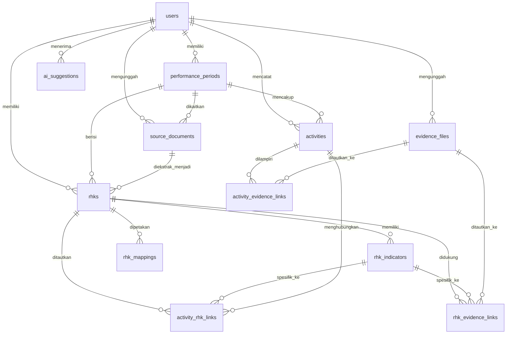

# Model Data Konseptual & Relasi Database — KinerjaKu

Dokumen ini mendefinisikan skema relasional PostgreSQL untuk aplikasi **KinerjaKu** sesuai Bagian 9 PRD.

---

## 1. Diagram Relasi Entitas (ERD)



---

## 2. Definisi Skema Tabel (DDL PostgreSQL)

### A. Tabel Pengguna & Periode
```sql
-- Pengguna
CREATE TABLE users (
    id UUID PRIMARY KEY DEFAULT gen_random_uuid(),
    email VARCHAR(255) UNIQUE NOT NULL,
    full_name VARCHAR(255),
    created_at TIMESTAMPTZ DEFAULT NOW(),
    updated_at TIMESTAMPTZ DEFAULT NOW()
);

-- Periode Kinerja (e.g., SKP 2024, Triwulan I 2025)
CREATE TABLE performance_periods (
    id UUID PRIMARY KEY DEFAULT gen_random_uuid(),
    user_id UUID NOT NULL REFERENCES users(id) ON DELETE CASCADE,
    name VARCHAR(100) NOT NULL,
    start_date DATE NOT NULL,
    end_date DATE NOT NULL,
    status VARCHAR(20) DEFAULT 'active' CHECK (status IN ('active', 'closed', 'archived')),
    notes TEXT,
    created_at TIMESTAMPTZ DEFAULT NOW(),
    updated_at TIMESTAMPTZ DEFAULT NOW()
);
CREATE INDEX idx_periods_user ON performance_periods(user_id);
```

### B. Dokumen Sumber & RHK
```sql
-- Dokumen Asli yang Diimpor (PDF RHK/Evaluasi)
CREATE TABLE source_documents (
    id UUID PRIMARY KEY DEFAULT gen_random_uuid(),
    user_id UUID NOT NULL REFERENCES users(id) ON DELETE CASCADE,
    period_id UUID REFERENCES performance_periods(id) ON DELETE SET NULL,
    storage_key VARCHAR(500) NOT NULL,
    document_type VARCHAR(50) DEFAULT 'pdf_rhk',
    original_filename VARCHAR(255) NOT NULL,
    imported_at TIMESTAMPTZ DEFAULT NOW(),
    extraction_status VARCHAR(30) DEFAULT 'pending' CHECK (extraction_status IN ('pending', 'processing', 'completed', 'failed')),
    extraction_summary JSONB,
    confirmed_at TIMESTAMPTZ
);

-- Bank RHK
CREATE TABLE rhks (
    id UUID PRIMARY KEY DEFAULT gen_random_uuid(),
    user_id UUID NOT NULL REFERENCES users(id) ON DELETE CASCADE,
    period_id UUID NOT NULL REFERENCES performance_periods(id) ON DELETE CASCADE,
    source_document_id UUID REFERENCES source_documents(id) ON DELETE SET NULL,
    intervened_lead_rhk TEXT, -- RHK Pimpinan yang diintervensi
    individual_rhk TEXT NOT NULL, -- RHK Utama / Tambahan Pegawai
    category VARCHAR(50) DEFAULT 'utama', -- 'utama' / 'tambahan'
    notes TEXT,
    status VARCHAR(30) DEFAULT 'active',
    created_at TIMESTAMPTZ DEFAULT NOW(),
    updated_at TIMESTAMPTZ DEFAULT NOW()
);
CREATE INDEX idx_rhks_period ON rhks(period_id);

-- Aspek & Indikator RHK
CREATE TABLE rhk_indicators (
    id UUID PRIMARY KEY DEFAULT gen_random_uuid(),
    rhk_id UUID NOT NULL REFERENCES rhks(id) ON DELETE CASCADE,
    aspect VARCHAR(50), -- Kuantitas, Kualitas, Waktu, atau custom
    indicator_text TEXT NOT NULL,
    target_value VARCHAR(100), -- Dapat berupa angka atau teks (e.g. '100', '1-2')
    target_unit VARCHAR(50),   -- e.g. 'Dokumen', 'Laporan', 'Bulan'
    target_period_text VARCHAR(100),
    source_text TEXT,
    review_status VARCHAR(30) DEFAULT 'confirmed' CHECK (review_status IN ('pending_review', 'confirmed', 'edited')),
    created_at TIMESTAMPTZ DEFAULT NOW(),
    updated_at TIMESTAMPTZ DEFAULT NOW()
);
CREATE INDEX idx_indicators_rhk ON rhk_indicators(rhk_id);
```

### C. Jurnal Aktivitas & Bank Bukti
```sql
-- Jurnal Aktivitas Harian
CREATE TABLE activities (
    id UUID PRIMARY KEY DEFAULT gen_random_uuid(),
    user_id UUID NOT NULL REFERENCES users(id) ON DELETE CASCADE,
    period_id UUID REFERENCES performance_periods(id) ON DELETE SET NULL,
    activity_date DATE NOT NULL DEFAULT CURRENT_DATE,
    activity_time TIME,
    description TEXT NOT NULL,
    result_notes TEXT,
    private_notes TEXT,
    categorization_status VARCHAR(30) DEFAULT 'uncategorized' CHECK (categorization_status IN ('uncategorized', 'categorized', 'needs_review')),
    created_at TIMESTAMPTZ DEFAULT NOW(),
    updated_at TIMESTAMPTZ DEFAULT NOW()
);
CREATE INDEX idx_activities_user_date ON activities(user_id, activity_date DESC);

-- Berkas Bukti Dukung (Metadata File di Cloud Storage)
CREATE TABLE evidence_files (
    id UUID PRIMARY KEY DEFAULT gen_random_uuid(),
    user_id UUID NOT NULL REFERENCES users(id) ON DELETE CASCADE,
    storage_key VARCHAR(500) NOT NULL,
    original_filename VARCHAR(255) NOT NULL,
    mime_type VARCHAR(100) NOT NULL,
    file_size BIGINT NOT NULL,
    checksum VARCHAR(64),
    uploaded_at TIMESTAMPTZ DEFAULT NOW(),
    evidence_date DATE,
    source_location VARCHAR(255),
    processing_status VARCHAR(30) DEFAULT 'uploaded' CHECK (processing_status IN ('uploaded', 'processing', 'completed', 'failed')),
    ai_summary TEXT,
    user_description TEXT,
    review_status VARCHAR(30) DEFAULT 'new' CHECK (review_status IN ('new', 'needs_review', 'categorized')),
    created_at TIMESTAMPTZ DEFAULT NOW(),
    updated_at TIMESTAMPTZ DEFAULT NOW()
);
CREATE INDEX idx_evidence_user ON evidence_files(user_id);
```

### D. Relasi M:N (Many-to-Many Linking)
```sql
-- Relasi Aktivitas <-> RHK/Indikator
CREATE TABLE activity_rhk_links (
    id UUID PRIMARY KEY DEFAULT gen_random_uuid(),
    activity_id UUID NOT NULL REFERENCES activities(id) ON DELETE CASCADE,
    rhk_id UUID NOT NULL REFERENCES rhks(id) ON DELETE CASCADE,
    indicator_id UUID REFERENCES rhk_indicators(id) ON DELETE SET NULL,
    link_source VARCHAR(30) DEFAULT 'manual' CHECK (link_source IN ('manual', 'ai_suggested', 'import')),
    confirmed_at TIMESTAMPTZ DEFAULT NOW(),
    notes TEXT,
    UNIQUE(activity_id, rhk_id, indicator_id)
);

-- Relasi Aktivitas <-> Berkas Bukti Dukung
CREATE TABLE activity_evidence_links (
    id UUID PRIMARY KEY DEFAULT gen_random_uuid(),
    activity_id UUID NOT NULL REFERENCES activities(id) ON DELETE CASCADE,
    evidence_file_id UUID NOT NULL REFERENCES evidence_files(id) ON DELETE RESTRICT,
    created_at TIMESTAMPTZ DEFAULT NOW(),
    UNIQUE(activity_id, evidence_file_id)
);

-- Relasi Langsung RHK <-> Berkas Bukti Dukung
CREATE TABLE rhk_evidence_links (
    id UUID PRIMARY KEY DEFAULT gen_random_uuid(),
    rhk_id UUID NOT NULL REFERENCES rhks(id) ON DELETE CASCADE,
    indicator_id UUID REFERENCES rhk_indicators(id) ON DELETE SET NULL,
    evidence_file_id UUID NOT NULL REFERENCES evidence_files(id) ON DELETE RESTRICT,
    link_source VARCHAR(30) DEFAULT 'manual' CHECK (link_source IN ('manual', 'ai_suggested')),
    confirmed_at TIMESTAMPTZ DEFAULT NOW(),
    notes TEXT,
    UNIQUE(rhk_id, indicator_id, evidence_file_id)
);
```

### E. Pemetaan RHK Antarperiode & Saran AI
```sql
-- Pemetaan RHK Antarperiode (Referensi)
CREATE TABLE rhk_mappings (
    id UUID PRIMARY KEY DEFAULT gen_random_uuid(),
    user_id UUID NOT NULL REFERENCES users(id) ON DELETE CASCADE,
    old_rhk_id UUID NOT NULL REFERENCES rhks(id) ON DELETE CASCADE,
    new_rhk_id UUID NOT NULL REFERENCES rhks(id) ON DELETE CASCADE,
    similarity_score NUMERIC(5,2),
    mapping_status VARCHAR(30) DEFAULT 'suggested' CHECK (mapping_status IN ('suggested', 'approved', 'rejected')),
    confirmed_at TIMESTAMPTZ,
    notes TEXT,
    created_at TIMESTAMPTZ DEFAULT NOW(),
    updated_at TIMESTAMPTZ DEFAULT NOW()
);

-- Log & Status Saran AI (User-in-the-Loop)
CREATE TABLE ai_suggestions (
    id UUID PRIMARY KEY DEFAULT gen_random_uuid(),
    user_id UUID NOT NULL REFERENCES users(id) ON DELETE CASCADE,
    entity_type VARCHAR(50) NOT NULL, -- 'evidence_file', 'activity', 'rhk_mapping'
    entity_id UUID NOT NULL,
    suggestion_type VARCHAR(50) NOT NULL, -- 'metadata', 'rhk_link', 'summary'
    suggestion_payload JSONB NOT NULL,
    confidence_label VARCHAR(30), -- 'high', 'medium', 'low', 'uncertain'
    status VARCHAR(30) DEFAULT 'pending' CHECK (status IN ('pending', 'accepted', 'modified', 'rejected')),
    created_at TIMESTAMPTZ DEFAULT NOW(),
    reviewed_at TIMESTAMPTZ
);
CREATE INDEX idx_ai_suggestions_entity ON ai_suggestions(entity_type, entity_id);
```

---

## 3. Integritas Relasi & Proteksi Hapus (Delete Guardrails)
- **Restriksi Penghapusan Berkas Bukti:** Tabel `activity_evidence_links` dan `rhk_evidence_links` menggunakan `ON DELETE RESTRICT` pada `evidence_file_id`. Berkas tidak dapat dihapus jika masih ditautkan aktif ke aktivitas atau RHK, mencegah terjadinya tautan rusak (*broken reference*).
- **Isolasi Periode:** Penghapusan sebuah periode atau pembuatan periode baru tidak mempengaruhi rekaman pada periode lain.
